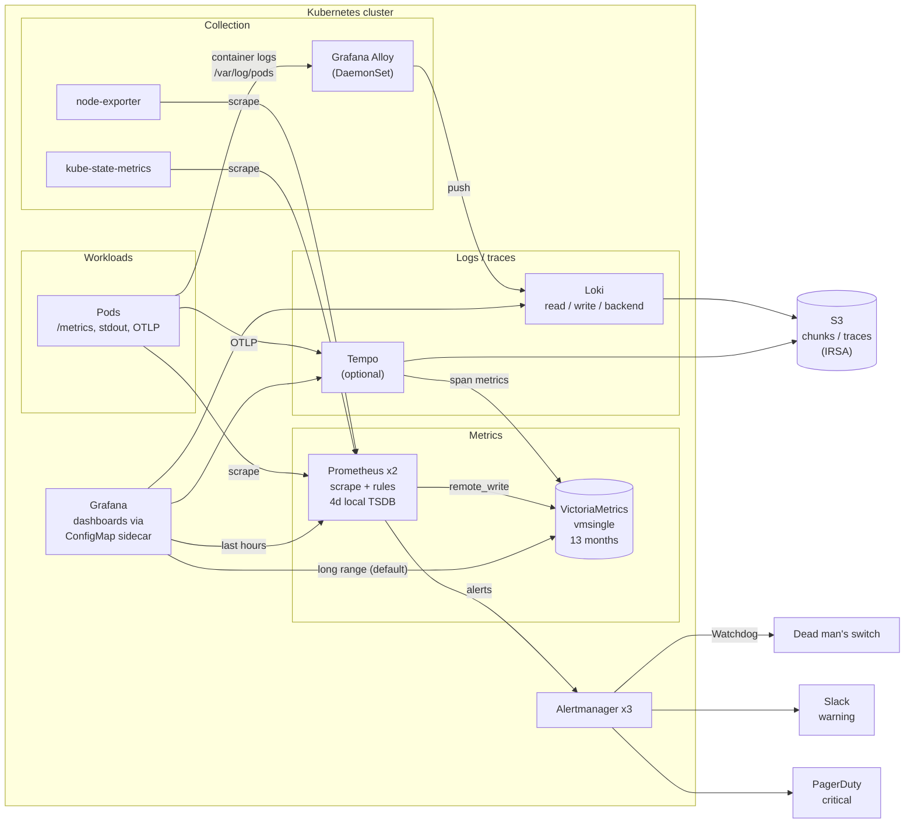

# k8s-observability-stack

[](https://github.com/ozy31/k8s-observability-stack/actions/workflows/ci.yml)
[](LICENSE)

An observability stack for Kubernetes that you deploy with GitOps. It covers
metrics, logs and optional traces, plus alerting that pages on user-facing
symptoms and SLO burn rates instead of on every CPU spike.

- **Metrics:** kube-prometheus-stack (Prometheus Operator, Prometheus,
  Alertmanager, Grafana). Prometheus keeps a few days locally and sends
  everything to **VictoriaMetrics** for long-term storage.
- **Logs:** **Loki** (Simple Scalable mode, S3 through IRSA). **Grafana Alloy**
  ships the logs.
- **Traces (optional):** **Tempo** on S3, linked to the logs in Grafana.
- **Alerting:** opinionated `PrometheusRule`s with `promtool` unit tests. SLOs
  use multi-window, multi-burn-rate alerts (hand-written, plus a Sloth-generated
  version for comparison). Alertmanager pages through PagerDuty for critical
  alerts and posts to Slack for warnings.
- **Dashboards:** cluster capacity and cost, SLO error budget, and log volume
  and errors. They are provisioned as ConfigMaps.
- **Delivery:** Argo CD app-of-apps, or plain Helm. There is also a kind setup
  for running it locally.
- **CI:** yamllint, `promtool check/test rules`, `amtool` routing tests,
  dashboard JSON and PromQL validation, `alloy validate`, and `helm template`
  piped to `kubeconform`.

## Architecture



Prometheus evaluates the alerting rules on its own local data. If long-term
storage is degraded, alerts keep working. Grafana uses VictoriaMetrics by
default, so dashboards can show months of history without making Prometheus
store it.

## Repository layout

```
.
├── argocd/
│   ├── project.yaml              AppProject (allowed repos/destinations)
│   ├── root.yaml                 app-of-apps entry point
│   ├── apps/                     one Application per component (pinned chart versions)
│   └── optional/tempo.yaml       enable by moving into apps/
├── values/                       Helm values per chart (production defaults)
├── alertmanager/
│   ├── values.yaml               routing tree, inhibition, templates (layered onto kps)
│   ├── routes-test.txt           routing assertions run by CI
│   ├── secret.example.yaml       shape of the receivers Secret (placeholders)
│   └── externalsecret.yaml       same Secret built from AWS Secrets Manager
├── alerts/                       PrometheusRule CRDs + kustomization
├── tests/                        promtool unit tests for every rule file
├── slo/
│   ├── example-api.sloth.yaml    Sloth SLO spec
│   └── generated/                Sloth output (checked for drift in CI)
├── dashboards/                   Grafana JSON + kustomization (ConfigMaps)
├── deploy/config/                kustomization: alerts + dashboards
├── docs/runbooks.md              runbook sections linked from every alert
├── local/                        kind cluster, local value overrides, demo service, Makefile
├── scripts/                      CI helpers (extract rules, validate, render)
└── Makefile                      `make ci` runs everything CI runs
```

## Component choices and trade-offs

### Prometheus for short retention, VictoriaMetrics for long retention

Prometheus is very good at scraping and evaluating rules. It is less suited to
being the only long-term store. Its local TSDB does not replicate, two HA
replicas each keep a full copy, and long retention makes restarts and
compaction heavier. This stack therefore keeps **4 days** locally and sends
every sample to VictoriaMetrics with `remote_write`. Four days is enough for the
longest alerting window, which is the 3-day slow SLO burn.

I chose **VictoriaMetrics** for that role for these reasons:

- **Low operating cost.** `vmsingle` is a single binary with a single PVC. It
  needs no object-storage pipeline, no compactor and no sidecars. Thanos and
  Mimir are both strong options, but they bring several more components to run
  and upgrade.
- **Storage efficiency.** VictoriaMetrics compresses better than the Prometheus
  TSDB and needs less RAM per active series, so 13 months of history fits on
  one modest volume. Size it from your own ingestion rate. Don't trust anyone's
  benchmark ratio, including this README's.
- **HA deduplication.** Both Prometheus replicas write the same series.
  `-dedup.minScrapeInterval=30s` keeps one copy.
- **Drop-in for queries.** VictoriaMetrics serves the Prometheus query API, and
  MetricsQL is a superset of PromQL. The same dashboards work against
  Prometheus or VictoriaMetrics, and you pick the source with the `datasource`
  variable.

**Single node or cluster.** `vmsingle` scales vertically and handles a few
million active series on one node. Its weak point is that the *history* lives
on one volume. If that volume is lost, the history is lost; alerting is not
affected. If VictoriaMetrics is down for a short time, Prometheus retries from
its WAL, which buffers roughly the last 2 hours. Switch to
`victoria-metrics-cluster` (vminsert, vmselect and vmstorage with
`-replicationFactor`) when you need the storage to survive a node or AZ loss,
or when you outgrow one node. The remote_write URL is the only change on the
Prometheus side.

### Loki: Simple Scalable on S3 with IRSA

- **Simple Scalable** (`read`, `write` and `backend` targets) is a good fit for
  small to mid-sized clusters. You get three StatefulSets or Deployments to scale
  instead of eight or more microservices. For a tiny cluster, or for local use,
  `SingleBinary` is enough; see `local/values/loki.yaml`. Move to the
  distributed mode only when the write or read path needs independent scaling.
- **S3 with IRSA.** The Loki ServiceAccount is annotated with an IAM role, so
  there are no access keys in Git or in Secrets. The role needs
  `s3:ListBucket`, `s3:GetObject`, `s3:PutObject` and `s3:DeleteObject` on the
  chunks and ruler buckets.
- **Schema v13 with the TSDB index.** Retention is enforced by the compactor
  (`retention_period: 744h`). Structured metadata is enabled.
- The OSS Loki and Tempo charts now come from the **`grafana-community`** Helm
  repo. The `grafana/loki` chart tracks the enterprise distribution.

### Grafana Alloy instead of Promtail

Promtail has reached end of life, and Alloy replaces it. Alloy runs as a
DaemonSet. Each instance discovers only the pods on its own node and tails
`/var/log/pods` directly, which costs less than streaming logs through the API
server. The pipeline is checked with `alloy validate` in CI.

### Loki label cardinality guidelines

Loki indexes **labels only**. Every unique combination of labels is a separate
stream, and too many streams is the most common way to make Loki slow and
expensive. The rules this stack follows:

| Use as a label (bounded, describes *where* a log comes from) | Never a label (unbounded, or describes *what* happened) |
|---|---|
| `cluster`, `namespace`, `app`, `container` | `trace_id`, `request_id`, `user_id`, `session_id` |
| `pod` (bounded by live pods; streams end when pods end) | HTTP path, status code, client IP |
| a small fixed `level` or `env` set, if you need one | anything taken from the log message body |

- Aim for **fewer than about 100k active streams**, with each stream receiving
  a steady flow of lines rather than many tiny streams. `max_global_streams_per_user`
  is a guard rail, not a target.
- Find values like `trace_id` at query time with line filters or parsers
  (`|= "abc123"`, `| json | status >= 500`), or keep them as **structured
  metadata**. Alloy does this for `trace_id`, so you can filter on it without
  creating a stream per trace.
- The log dashboard shows **active streams** and **discarded samples by
  reason**. A jump in either after a deploy almost always means someone added
  a high-cardinality label.

### Tempo (optional)

Tempo runs as a single binary on S3 with IRSA. Applications send OTLP to
`tempo.monitoring:4317` or `:4318`. The metrics generator writes span metrics
and the service graph to VictoriaMetrics. The Grafana data sources link in both
directions: a trace ID in a log line opens the trace, and a span opens its logs.
It is off by default because tracing only pays off once applications are
instrumented.

## Alerting philosophy

1. **Page on symptoms, not causes.** A page means users are affected now, or
   will be soon and nobody can wait until morning. High CPU, a restarting pod
   or a full node are *causes*. They become warnings, or they appear only on
   dashboards. What pages:
   - SLO **fast burn**, meaning user-facing errors or latency;
   - **imminent, self-inflicted outages**: a PVC that is about to fill up, a
     certificate that expires within 7 days.
2. **SLO burn-rate alerts instead of threshold alerts.** These follow the Google
   SRE Workbook's multi-window, multi-burn-rate approach. A *burn rate* of 1
   uses exactly the error budget over 30 days.

   | Severity | Burn rate | Long window | Short window | Budget used when it fires |
   |---|---|---|---|---|
   | critical (page) | 14.4 | 1h | 5m | 2% |
   | critical (page) | 6 | 6h | 30m | 5% |
   | warning (ticket) | 3 | 1d | 2h | 10% |
   | warning (ticket) | 1 | 3d | 6h | 10% |

   The long window makes sure the problem is significant. The short window
   makes the alert resolve quickly once the problem is fixed. The unit tests
   include the case that sold me on this design: a 3-minute error spike after
   hours of clean traffic would trip a plain 5-minute threshold alert, but it
   does **not** page here.
3. **A fixed severity contract.** CI fails if an alert has a missing or unknown
   severity, or has no `summary` or `runbook_url`.

   | severity | Route | Expectation |
   |---|---|---|
   | `critical` | PagerDuty, mirrored to `#alerts-critical` | someone acts now |
   | `warning` | Slack `#alerts-warning`, repeated every 12h | handled during working hours |
   | `info` | not routed | context on dashboards and in the Alertmanager UI |
4. **Grouping that respects silences.** Alerts are grouped by
   `alertname, cluster, namespace, service`, which gives one notification per
   problem rather than one per pod. Silencing a namespace or a service
   therefore works as expected.
5. **Inhibition.** A critical alert mutes the warning for the same alert and
   namespace. A fast burn mutes the slow burn. `KubeNodeNotReady` mutes the
   pressure alerts on the same node. A critical certificate alert mutes the
   matching early warning.
6. **Watching the watcher.** The always-firing `Watchdog` alert goes to a dead
   man's switch, an external service that alerts you when the heartbeat
   *stops*.
7. **Every alert is tested.** `tests/` has `promtool` unit tests for both the
   firing and the non-firing cases, and `alertmanager/routes-test.txt` checks
   the routing tree.

kube-prometheus-stack's own default rules stay enabled, apart from the groups
that `alerts/` replaces (`kubernetesApps`, `kubernetesStorage`, and the node
readiness and pressure alerts). Control-plane rules are turned off because
managed control planes can't be scraped.

### SLOs: hand-written and generated

`alerts/slo-example-api.yaml` declares the SLOs for an example HTTP service:

- **availability:** 99.9% of requests are not 5xx;
- **latency:** 99% of requests finish in under 250 ms;
  the threshold has to be one of the histogram's bucket boundaries (`le="0.25"`
  is one of the Prometheus client defaults);
- both over a 30-day window.

The file follows a naming convention, so the two generic alerts
(`SLOErrorBudgetBurnFast` and `SLOErrorBudgetBurnSlow`) and the SLO dashboard
work for any service that records the same series:

```
service_slo:error_budget:ratio{service, slo}          1 - objective
service_slo:sli_error:ratio_rate{5m,30m,1h,2h,6h,1d,3d}{service, slo}
service_slo:sli_total:rate5m / service_slo:sli_bad:rate5m{service, slo}
```

Adding a service means copying the recording group and changing the selectors
and objectives. The alerts stay the same.

`slo/example-api.sloth.yaml` describes the same SLOs as a
[Sloth](https://github.com/slok/sloth) spec, and `slo/generated/` holds Sloth's
output. CI regenerates it and fails on drift. Both versions are checked by
`promtool` and unit-tested. Use **one** of them per service, otherwise you get
two pages. Sloth is the better choice once there are many services, because it
writes the boilerplate for you. The hand-written version is easier to review
and to explain. Note that Sloth also records 30-day rollups, which need 30 days
of data where the rules are evaluated. With the 4-day Prometheus in this stack,
evaluate them with `vmalert` against VictoriaMetrics, or ignore those series.

The **30-day error budget** on the dashboard is computed in VictoriaMetrics from
the 5m event rates
(`sum_over_time(bad[30d]) / sum_over_time(total[30d])`), weighted by traffic.
Prometheus doesn't need 30 days of data for it.

## Dashboards

All three dashboards use a `datasource` variable, contain no hard-coded UIDs,
and are loaded by the Grafana sidecar from ConfigMaps labelled
`grafana_dashboard: "1"`. The `grafana_folder` annotation picks the folder.

| Dashboard | What it answers |
|---|---|
| **Kubernetes / Cluster Overview & Cost** (`k8s-cluster-cost`) | How full is the cluster (allocatable, requested, used)? Which namespaces request much more than they use? What does each namespace cost, and how much of the bill is idle capacity? |
| **SLO / Error Budget** (`slo-error-budget`) | How much budget is left this 30-day window? How fast is it burning in each alert window? When did the SLO alerts fire? |
| **Logs / Volume & Errors** (`loki-logs-overview`) | Which apps produce the most log volume and the most error lines? Is Loki dropping data (rate limits, stream limits), and is the stream count rising? |

**About the cost model.** The cost dashboard charges each namespace
`max(requested, used)` of CPU and memory. It prices them by splitting a node's
price 50/50 between vCPU and memory. You set the node price, vCPU count and
memory size as variables (the default is an m6i.xlarge-like node at
$0.192/h). It is a deliberate simplification, good for ranking namespaces and
spotting waste, not for chargeback. For invoice-grade numbers that include
spot, savings plans, storage and network, use OpenCost or your cloud's cost
export.

## Deploying

### Prerequisites

- Kubernetes 1.30 or later. The examples assume **EKS**: a `gp3` StorageClass
  and IRSA. On other clouds, change the StorageClass and the identity
  annotations.
- S3 buckets and IAM roles for Loki (and for Tempo if you enable it). Put the
  role ARNs in `values/loki.yaml` and `values/tempo.yaml`.
- Two Secrets in `monitoring`:
  - `alertmanager-receivers`, holding the PagerDuty routing key, the Slack
    webhooks and the dead man's switch URL. See `alertmanager/secret.example.yaml`
    for the keys, and `alertmanager/externalsecret.yaml` to build it from AWS
    Secrets Manager.
  - `grafana-admin`, with the keys `admin-user` and `admin-password`.

### With Argo CD

```sh
# 1. Fork, then set your repo URL
grep -rl 'github.com/ozy31/k8s-observability-stack' argocd | xargs sed -i 's#ozy31/k8s-observability-stack#<you>/<repo>#'

# 2. Adjust values/ (cluster name, region, buckets, role ARNs, storage class)

# 3. Bootstrap once — Argo CD takes it from there
kubectl apply -n argocd -f argocd/project.yaml -f argocd/root.yaml
```

Sync waves set the order: kube-prometheus-stack (including its CRDs) and
VictoriaMetrics first, then Loki and Tempo, then Alloy, then
`observability-config` (rules and dashboards). Every Application uses
`ServerSideApply=true`, because the Prometheus Operator CRDs are too large for
client-side apply. Chart versions are pinned in `argocd/apps/*.yaml`, which is
the only place versions are defined. The local Makefile and CI read them from
there.

To enable Tempo, run `git mv argocd/optional/tempo.yaml argocd/apps/`.

### With plain Helm

```sh
helm upgrade --install kps kube-prometheus-stack \
  --repo https://prometheus-community.github.io/helm-charts --version 92.11.0 \
  -n monitoring --create-namespace \
  -f values/kube-prometheus-stack.yaml -f alertmanager/values.yaml

helm upgrade --install vmsingle victoria-metrics-single \
  --repo https://victoriametrics.github.io/helm-charts --version 0.49.0 \
  -n monitoring -f values/victoria-metrics-single.yaml

helm upgrade --install loki loki \
  --repo https://grafana-community.github.io/helm-charts --version 19.1.1 \
  -n monitoring -f values/loki.yaml

helm upgrade --install alloy alloy \
  --repo https://grafana.github.io/helm-charts --version 1.14.2 \
  -n monitoring -f values/alloy.yaml

kubectl apply --server-side -k deploy/config
```

### Locally with kind

The local setup needs `kind`, `kubectl`, `helm`, `yq` and Docker.

```sh
make -C local up          # 3-node kind cluster, full stack, demo service + load generator
make -C local grafana     # http://localhost:3000  (admin / admin)
make -C local down
```

Local overrides (`local/values/`) switch Loki to a single binary on the
filesystem, drop replicas and persistence, and label everything
`cluster="kind"`. `local/example-api.yaml` deploys an instrumented demo service
called `example-api`, so the SLO rules and the SLO dashboard have real data.
The Alertmanager Secret holds placeholders, so notifications fail to send while
routing still works. You can inspect it in the Alertmanager UI with
`make -C local alertmanager`.

## Development

```sh
./scripts/install-tools.sh && export PATH="$PWD/bin:$PATH"   # pinned promtool, amtool, kubeconform, yq, sloth, alloy
pip install yamllint
make ci        # everything CI runs
make help      # individual targets
```

| Target | What it checks |
|---|---|
| `lint` | yamllint (strict) |
| `rules-check` | Extracts `.spec` from every PrometheusRule and runs `promtool check rules`, plus the severity and annotation policy |
| `rules-test` | `promtool test rules tests/*.yaml` |
| `slo-check` | `sloth validate`, plus a regenerate-and-diff of `slo/generated/` |
| `alertmanager-check` | `amtool check-config`, plus routing assertions |
| `dashboards-check` | JSON validity, unique UIDs and panel IDs, no hard-coded data sources, every PromQL query parses |
| `alloy-check` | `alloy validate` on the log pipeline |
| `kubeconform` | `helm template` of every Application (production and local values) and the kustomize output, validated against Kubernetes and CRD schemas |

## Adapting it

Values to change before you use this for real:

- `cluster` external label (`values/kube-prometheus-stack.yaml`) and `CLUSTER_NAME` (`values/alloy.yaml`)
- AWS account, region, buckets and role ARNs (`values/loki.yaml`, `values/tempo.yaml`)
- `storageClassName` (`gp3`) wherever a PVC is created
- the Grafana URL in the SLO alerts' `dashboard_url`, and the runbook base URL
- Slack channel names in `alertmanager/values.yaml`
- the SLO selectors (`job="example-api"`) and objectives, for your services

## License

[MIT](LICENSE) © Ahmet Ozan Gazi
